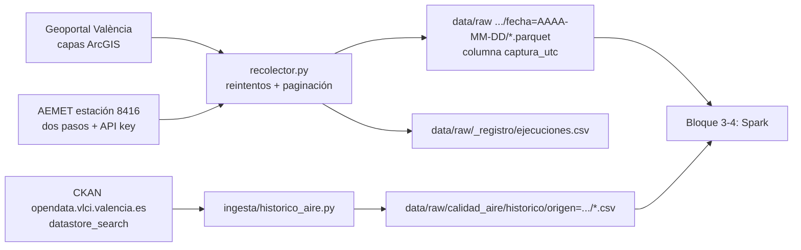

# Práctica P4 — Bloque 1: recolector de datos abiertos de València

Recolector programable que descarga las capas del Geoportal de València, la observación de AEMET y el histórico de calidad del aire (CKAN), y deja cada captura en `data/raw` repartida por carpetas de fecha. Está pensado para correr en un planificador (cron) varias veces al día durante meses, así que todo lo que guarda ya es Parquet y toda ejecución queda apuntada en un CSV de registro.

## 1. Cómo ejecutar

```powershell
pip install requests pyarrow python-dotenv
```

- API key de AEMET en `recolector/.env` (fuera de Git): `AEMET_API_KEY=...`
- Captura puntual del recolector:

```powershell
python recolector\recolector.py            # todas las fuentes
python recolector\recolector.py estado     # una o varias concretas
```

- Carga única del histórico de aire (2016–2021 y 2021–2022):

```powershell
python ingesta\historico_aire.py           # se salta lo ya descargado
python ingesta\historico_aire.py --forzar  # fuerza la re-descarga
```

- En el servidor (Linux) la programación de `recolector/crontab` se instala con `crontab -e` y las salidas van a `logs/`.

## 2. Estructura del proyecto

```text
Practica_4_Bloque_1_resolved/
├── recolector/
│   ├── recolector.py     # captura por fuente (apartados 3-5, 7)
│   ├── crontab           # programa de cron por fuente (apartado 7)
│   └── .env              # API key de AEMET (no se sube a Git)
├── ingesta/
│   └── historico_aire.py # carga única del histórico CKAN (apartado 8)
├── data/raw/
│   ├── trafico/{espiras,tramos,estado}/fecha=AAAA-MM-DD/   # Parquet
│   ├── calidad_aire/estaciones/ y calidad_aire/historico/origen=.../
│   ├── meteo/municipal/
│   ├── aemet/8416/
│   ├── nifi/                       # capturas hechas con el flujo NiFi (apartado 9)
│   └── _registro/ejecuciones.csv   # aquí se apuntan los huecos
├── logs/
└── nifi/
```

## 3. Bitácora de prácticas — Bloque 1

### Tabla de fuentes

| Fuente | Origen | Qué representa | Geometría | Cadencia del origen | Frecuencia de ingesta |
|---|---|---|---|---|---|
| `espiras` | Geoportal `Trafico/MapServer/208` | Un sensor en un punto | Punto | Cada hora | Cada hora |
| `tramos` | Geoportal `Trafico/MapServer/188` | Un tramo de calle | Línea | Tiempo real | Cada 5 min |
| `estado` | Geoportal `Trafico/MapServer/192` | Nivel de tráfico por tramo | Línea | Tiempo real (~3 min) | Cada 3 min |
| `aire` | Geoportal `MedioAmbiente/MapServer/156` | Estaciones de calidad del aire | Punto | Poco frecuente | Cada hora |
| `meteo` | Geoportal `MedioAmbiente/MapServer/157` | Estaciones meteorológicas municipales | Punto | Poco frecuente | Cada hora |
| `aemet` | opendata.aemet.es, observación de la estación 8416 | Mediciones con variables meteorológicas | — | Horaria | Cada hora |
| histórico aire | CKAN VLCi, recursos 2016–2021 y 2021–2022 | Series horarias por estación, 2016–2022 | — | Cerrado (dos ficheros) | Carga única |

La capa del Geoportal se consulta siempre igual (`datastore` aparte): donde, campos y paginación por `exceededTransferLimit`. En AEMET hace falta API key (va en `.env`), y entre capturas hay solapamiento de ~24 h que se deduplicará en el Bloque 4.

### Diagrama de la ingesta



### Programación con cron (apartado 7)

`recolector.py` acepta los nombres de las fuentes como argumentos (sin argumentos baja todas), así que cron puede llamarlo con una frecuencia distinta por fuente. La programación elegida, con desfase en los minutos para que las llamadas horarias nunca coincidan:

| Fuente | Expresión | Frecuencia |
|---|---|---|
| `estado` | `*/3 * * * *` | cada 3 min (exactamente la cadencia de la capa) |
| `tramos` | `*/5 * * * *` | cada 5 min (tiempo real también, pero basta así) |
| `espiras` | `5 * * * *` | cada hora, minuto 5 |
| `aire` | `15 * * * *` | cada hora, con desfase |
| `meteo` | `20 * * * *` | cada hora, con desfase |
| `aemet` | `25 * * * *` | cada hora (AEMET emite la observación por horas) |

El fichero completo está en `recolector/crontab`, con redirección de cada línea a `logs/cron_<fuente>.log`.

### Incidencias con las fuentes

1. **`exceededTransferLimit` en tramos y estado.** Las capas tramos y estado no entran en una sola query, por eso la descarga pagina con `resultOffset` hasta que el flag desaparece. Con espiras no pasa (cabe en una página).
2. **Reintentos por 429.** AEMET y el Geoportal sueltan de vez en cuando errores 429/5xx o cortes de conexión; el GET reintenta hasta 3 veces esperando 10 y 20 s. Aun así, alguna ejecución falla de verdad: para eso está `_registro/ejecuciones.csv` (columna `ok` a 0 y el texto del error), que es la fuente para medir huecos en el Bloque 4.
3. **Formatos inconsistentes en el histórico CKAN.** Los dos recursos del histórico no traen fechas iguales: en 2016–2021 la fecha llega como `2020-01-01T00:00:00` y en 2021–2022 como `2021-03-07`; la hora aparece un rato con segundos (`14:00:00`) y otro sin (`4:00`). Por eso el script guarda todo el CSV como texto tal cual, sin parsear nada.
4. **Día y mes intercambiados.** En 2021–2022 hay filas donde la fecha `Fecha` y la columna `Dia del mes` no concuerdan (visto, por ejemplo, `Fecha = 2022-10-05` con `Dia del mes = 10`). También salió la estación "Conselleria Meteo" sin ningún contaminante, solo variables meteo: filas a null legítimas, no errores. Arreglar ambas cosas es trabajo del Bloque 4.
5. **Nombres de columna no aptos para Spark.** El histórico trae columnas como `PM2.5`, `Humedad relativa` o `Dia de la semana`; se normalizan al vuelo a minúsculas sin tildes ni espacios (`pm2_5`, `humedad_relativa`, `dia_de_la_semana`). Los valores no se tocan.
6. **Recursos duplicados en el CKAN.** El histórico aparece en varios paquetes (uno "2016-2020" con 352.666 filas y otro "desde 2016" con 449.026). El script usa los dos en castellano que evitan el recorte: 449.026 filas para 2016–2021 y 201.480 para 2021–2022, de forma que la descarga cuadra con lo estimado en el enunciado (~449.000 y ~201.000).

### Apagar y encender el recolector en Windows

En Windows el `recolector/ejecutar.cmd` no se queda corriendo: lo van llamando 6 tareas del Programador de Tareas (una por fuente, dentro de la carpeta `\P4_BigData\`), que es el equivalente al crontab. Para apagarlo del todo (deja de programarse, los datos de `data/raw` se quedan como están):

```powershell
Get-ScheduledTask -TaskPath '\P4_BigData\' | Disable-ScheduledTask
```

Para encenderlo de nuevo, igual con `Enable-ScheduledTask` (todas, o solo una concretando `-TaskName 'estado'`):

```powershell
Get-ScheduledTask -TaskPath '\P4_BigData\' | Enable-ScheduledTask
Enable-ScheduledTask -TaskPath '\P4_BigData\' -TaskName 'estado'
```

Si se quiere eliminar del todo en vez de desactivar: `Unregister-ScheduledTask` (y habría que volver a crear las tareas si hacen falta). Para cortar una ejecución que esté corriendo en ese momento, `Ctrl+C` en su ventana o `Stop-ScheduledTask -TaskPath '\P4_BigData\' -TaskName <fuente>`. También se puede ver y gestionar todo desde la interfaz gráfica con `taskschd.msc` → carpeta *P4_BigData*. En el servidor Linux esto no hace falta: apagar es comentar (o borrar) las líneas del `crontab` con `crontab -e`.

### Ampliación con NiFi (apartado 9, opcional)

El servicio `nifi` del `docker-compose.yml` levanta Apache NiFi 1.28.1 en https://localhost:8443/nifi (usuario `admin`; el navegador avisará del certificado autofirmado). La carpeta `data/raw/nifi` del proyecto está montada dentro del contenedor en `/data/raw/nifi`, así que lo que escriba PutFile se queda en el proyecto y sobrevive a `docker compose down`.

```powershell
docker compose up -d nifi
```

Flujo de espiras (equivalente a `recolector.py espiras`), de izquierda a derecha:

| Procesador | Configuración clave |
|---|---|
| InvokeHTTP | `https://geoportal.valencia.es/server/rest/services/OPENDATA/Trafico/MapServer/208/query?where=1%3D1&outFields=*&f=json`, GET, *Run Schedule* `1 hour` |
| EvaluateJsonPath | Propiedad `features` → `$.features`, *Destination* `flowfile-content` (el contenido pasa a ser solo el array) |
| SplitJson | *JsonPath Expression* `$[*]` → un flowfile por punto de medida |
| PutFile | *Directory* `/data/raw/nifi`, *Filename* `${now():format("yyyyMMdd_HHmmss", "UTC")}_${fragment.index}.json`, *Create Missing Directories* activado |

La definición completa del flujo está exportada en `nifi/flujo_espiras.json` (formato *flow definition* de NiFi, el mismo que da *Download flow definition*). Se importa desde el menú global (☰) → *Upload flow definition*; NiFi crea el grupo con los 4 procesadores ya cableados y configurados, listo para arrancar y hacer la captura.

Con el flujo en marcha se observan los contadores de cada procesador, las colas entre ellos y el Data Provenance de un flowfile (apartado 5, Scripts vs NiFi). El recolector en Python sigue siendo la solución principal: NiFi solo reproduce la captura de espiras.

### Tabla comparativa: scripts vs NiFi (apartado 5)

Comparativa entre `recolector.py` (la solución del proyecto) y el flujo NiFi de espiras montado en la ampliación:

| Criterio | Script Python (`recolector.py`) | Flujo NiFi (espiras) |
|---|---|---|
| Puesta en marcha | Solo Python (`pip install requests pyarrow`) y ejecutar el script | Docker + NiFi (~1 GB de RAM) y navegador con la UI |
| Esfuerzo por fuente | ~20–30 líneas por fuente dentro de un mismo script | 4 procesadores configurados a mano en la UI por cada fuente |
| Reintentos ante 429/5xx | Codificados a mano: 3 intentos esperando 10 y 20 s | InvokeHTTP reintenta solo (*Yield/Penalty/Retry*), sin escribir código |
| Paginación (`exceededTransferLimit`) | Bucle con `resultOffset` ya implementado | No existe un "for": exigiría un bucle de procesadores, mucho más enrevesado |
| Programación por fuente | `crontab` con una expresión por fuente (`*/3`, `*/5`, horarias desfasadas) | *Run Schedule* en cada procesador (InvokeHTTP a `1 hour`) |
| Formato de salida | Parquet con `captura_utc` y partición `fecha=AAAA-MM-DD` | JSON plano con PutFile; Parquet exigiría ConvertRecord + un writer Avro/Parquet |
| Registro de ejecuciones | `data/raw/_registro/ejecuciones.csv`, base para medir huecos | Data Provenance consultable en la UI, pero no exporta un CSV de ejecuciones |
| Monitorización en vivo | Logs de cron en `logs/`, a posteriori | Contadores, colas y avisos (bulletins) en tiempo real en el canvas |
| Versionado / despliegue | El código es texto plano en Git | El flujo se versiona exportándolo a JSON (`nifi/flujo_espiras.json`) |
| Veredicto | Solución principal del proyecto | Útil para prototipar una fuente y para observar el flujo visualmente |
